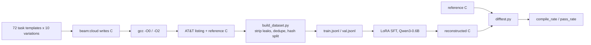

<div align="center">


# kind_picture

### Teaching a 0.6B model to read x86-64 assembly and write back working C


**A narrow, mechanically verifiable code model that runs on a laptop.**

[Pipeline](#pipeline) · [Results](#results) · [Quick start](#quick-start) · [Roadmap](#roadmap) · [Docs](#docs)

</div>

---

> **Status (2026-10-21):** the pipeline works end-to-end, and the first full
> LoRA run is complete. The adapter compiles **73.1%** of validation answers
> (up from 26.9% for the base model), but behavior match is still **0%** — the
> remaining gap is algorithmic, not syntactic. Numbers are reported as they
> are.

## The idea

Most code models are trained on the easy direction: source code → assembly.
Reverse engineering needs the opposite. Given a compiler listing, recover C
that **behaves the same** — and prove it mechanically.

That constraint is what makes this project interesting:

- **Ground truth by construction.** A hosted C program is compiled by gcc at
  `-O0` and `-O2`; the listings are the input, the original C is the target.
  No human labels, no synthetic guesses.
- **Correctness is behavioral, not textual.** The predicted C and the
  reference C are compiled with the same gcc and run on identical stdin. Same
  stdout and exit code on every probe means the reconstruction is correct —
  even if the code looks completely different.
- **Leak-free by design.** `-fverbose-asm` embeds the original source lines in
  comments. The dataset builder removes exactly those lines, so the model
  cannot win by copying.
- **Small enough to own.** Qwen3-0.6B plus a 10.1M-parameter LoRA adapter fits
  a 6 GB laptop GPU. The goal is a domain model you can run, inspect and
  retrain yourself — not an API bill.

## Pipeline



The two data lines are deliberately kept apart:

| Line | Input | Correctness established by | Status |
|------|-------|----------------------------|--------|
| **A1** | gcc-generated hosted C listings (`main`, libc) | ground truth by construction | collecting + training |
| **B** | freestanding `_start` programs, syscalls only | `verifier.py` test runs | planned |

Mixing them would create contradictory answers for the same question: hosted
code uses libc and PLT calls, freestanding code talks to the kernel directly.

## Results

| Run | Validation | Compiles | Same behavior | What it shows |
|-----|-----------:|---------:|--------------:|---------------|
| Base Qwen3-0.6B | 26 pairs | 26.9% | 0% | the starting point: often copies the listing into a `c` block |
| Smoke LoRA, 60 pairs x 3 epochs | 16 pairs* | 37.5% | 0% | format learned: **16/16** answers are C; expected to overfit |
| Full LoRA, 723 pairs x 2 epochs | 26 pairs | **73.1%** | 0% | structure learned: all 26 answers are C; behavior is the remaining gap |

\* The smoke run used the earlier 16-pair split, so it is not directly
comparable with the 26-pair baseline. Its purpose was to validate the training
loop, not to claim accuracy.

<picture>
  <source media="(prefers-color-scheme: dark)" srcset="ml/asm/docs/training_loss_full_dark.png">
  
</picture>

Cross-entropy on assistant tokens only: the system prompt, the question and
the assembly listing are masked with `-100`, so every gradient comes from the
C answer. Loss falls from 0.81 to 0.06 over 182 optimizer steps (epoch
averages: 0.32 and 0.14). The adapter compiles 19 of 26 validation answers
(73.1%, up from 7), but none matches the reference behavior yet: it has
learned the shape of the task, not the algorithm.

## Dataset at a glance

| Metric | Value |
|--------|-------|
| Programs collected | **803** (collector still running) |
| Programs in the current dataset snapshot | 679 |
| Listings (`-O0` + `-O2`) | **1,302** |
| Train / validation pairs | **1,276 / 26**, split by hashed source id |
| Prompt space | 72 tasks x 10 wording variations = **720** |
| Duplicates removed / compile failures excluded | 30 / 26 |

Every pair carries two views of the same program: `-O0` preserves the source
structure, `-O2` shows what the optimizer does to it. The split is by source
record, so both optimization levels of one program always land on the same
side.

## Quick start

Requirements: Python 3.13, `gcc`/`binutils`, and for training a CUDA GPU
(the current runs use an RTX 3050 Laptop with 6 GB). Versions used here:
PyTorch 2.6.0+cu124, Transformers 5.20.2, PEFT 0.21.2, Accelerate 1.15.0,
Matplotlib 3.11.2 (for the training-loss figures).

```bash
python3 -m venv .venv
source .venv/bin/activate
pip install torch==2.6.0 --index-url https://download.pytorch.org/whl/cu124
pip install transformers peft accelerate matplotlib requests
```

Build the dataset from the collected shards, train, and evaluate:

```bash
# 1. rebuild train/val from ml/asm/raw_c/ (safe while the collector runs)
python3 ml/asm/build_dataset.py

# 2. smoke test the training loop on 60 short pairs
python3 ml/asm/train.py --limit 60 --epochs 3 --max-seq-len 1024 \
    --grad-accum 4 --tag smoke

# 3. full run
python3 ml/asm/train.py --epochs 2 --max-seq-len 2048 \
    --grad-accum 8 --tag full

# 4. compare the base model and the adapter on the same validation set
python3 ml/asm/eval.py --model Qwen/Qwen3-0.6B --tag base
python3 ml/asm/eval.py --model Qwen/Qwen3-0.6B \
    --adapter ml/asm/checkpoints/lora-full/final --tag full

# 5. regenerate the training-loss figure (light + dark PNG, matplotlib)
python3 ml/asm/plot_training.py
python3 ml/asm/plot_training.py \
    --state ml/asm/checkpoints/lora-full/train_state.json \
    --stem training_loss_full
```

Collect more programs (needs a logged-in Ollama Cloud account and the
`beam:cloud` model):

```bash
cd ml/asm
python3 gen_c.py --once      # one sample
python3 gen_c.py             # endless, crash-safe collection
python3 gen_c.py --status    # checkpoint and error statistics
```

## Repository layout

```
kind_picture/
├── ml/asm/                 asm → C pipeline (the main project)
│   ├── gen_c.py            collector: task → C → gcc -O0/-O2 listings
│   ├── build_dataset.py    leak stripping, dedupe, train/val split
│   ├── difftest.py         behavioral equivalence checker
│   ├── eval.py             compile_rate / pass_rate on validation pairs
│   ├── train.py            LoRA SFT with masked loss
│   ├── plot_training.py    light/dark training-loss figures
│   ├── verifier.py         freestanding asm runner (line B)
│   └── docs/               figures used by the READMEs
├── dset/                   earlier general-programming corpus collector
├── legacy/                 archived first corpus, with SHA-256 checksums
├── docs/                   notes
└── README.md
```

## Roadmap

- [x] Crash-safe collector with atomic checkpoints and backoff
- [x] Dataset builder with source-line leak stripping and deduplication
- [x] Differential tester with timeouts, memory limits and signal handling
- [x] Evaluation harness: `compile_rate`, `pass_rate`, per-optimization split
- [x] LoRA training with assistant-only loss and memory-aware logits
- [x] First full training run: 73.1% compile rate on unseen pairs
- [ ] First full run with a non-zero `pass_rate` on unseen tasks
- [ ] Line B: freestanding `_start` programs verified by `verifier.py`
- [ ] A larger model on a two-GPU server
- [ ] Inference CLI: listing in, verifiable C out

## Limitations

This is an early research prototype, and the README says so on purpose:

- The task is narrow: small hosted C programs generated from 72 templates,
  compiled by gcc. It is not a general-purpose decompiler.
- The current model is 0.6B parameters. After the first full run, 73.1% of
  unseen answers compile but behavior match is still 0%; the model reproduces
  task shape, not yet the exact algorithm.
- Training skips pairs longer than `--max-seq-len` (2,048 tokens in the current
  run) rather than truncating them. Long programs are underrepresented.
- The corpus comes from a single cloud model, so its style and mistakes are
  baked into the data.
- Line B (freestanding assembly) is designed but not collected yet.

## Docs

- [ml/asm/README.md](ml/asm/README.md) — full pipeline reference: record
  format, leak stripping, differential-testing rules, exit codes, training
  details.
- [dset/README.md](dset/README.md) — the earlier general-programming corpus
  collector.
- [legacy/README.md](legacy/README.md) — archived first corpus, checksums and
  restore instructions.

<div align="center">

Built on **Qwen3-0.6B** with PyTorch, Transformers and PEFT.

</div>
