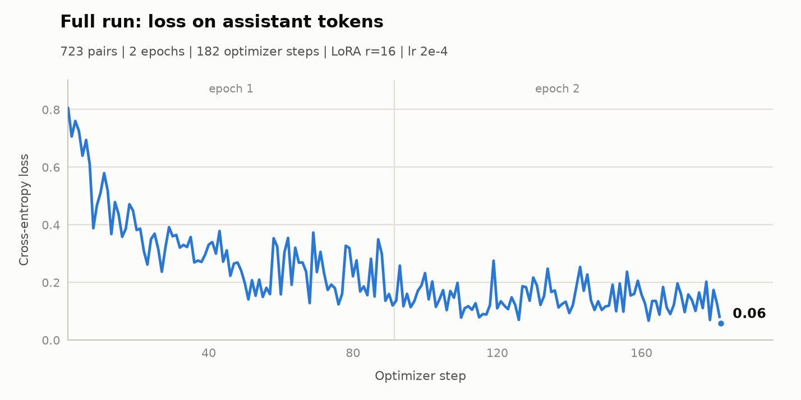

# ml/asm — x86-64 asm → C dataset pipeline

Narrow-domain dataset for a small programming model working with x86-64
assembly in AT&T syntax (the syntax `gcc -S` emits).

The current goal is **asm → C reconstruction**: the model is given a compiler
listing and must reconstruct C code with the same observable behavior.
Correctness is checked mechanically by **differential testing**, not by string
comparison — any C program that behaves the same as the original is a correct
answer.

## Two data lines, kept separate

| Line | What it produces | How correctness is established | File |
|------|------------------|-------------------------------|------|
| A1 (current) | task → C program → two gcc listings (`-O0`, `-O2`) | ground truth by construction: the asm was made by the compiler | `gen_c.py` |
| B (planned) | task → freestanding asm program (`_start`, syscalls only) | test run via `verifier.py` | — |

They are not mixed into one dataset: A1 is hosted code (`main`, libc, PLT),
B is freestanding code (`_start`, no libc). The same question would have two
contradictory correct answers, which turns into label noise for a small model.

## Pipeline

```
gen_c.py ──► raw_c/shard_*.jsonl ──► build_dataset.py ──► dataset/train.jsonl
                                                          dataset/val.jsonl
                                                               │
model answer (C) ──► difftest.py: original C vs predicted C ──► verdict
```

## Files

- `gen_c.py` — collector for line A1: asks the model (`beam:cloud`) for a C
  program, compiles it with gcc at `-O0` and `-O2`, stores both listings.
- `build_dataset.py` — turns raw shards into chat-format JSONL pairs
  (listing → original C), with leak stripping, deduplication and a
  train/val split.
- `difftest.py` — differential tester: compiles the reference C and a
  predicted C, runs both on the same stdin inputs, compares stdout and exit
  codes.
- `eval.py` — evaluates a local model (base or LoRA-tuned) on `val.jsonl`:
  greedy generation, C extraction, `difftest` check, `compile_rate` and
  `pass_rate`; writes predictions and a summary JSON.
- `train.py` — LoRA SFT of Qwen3-0.6B on `train.jsonl`. The loss is computed
  only on the assistant's C answer: prompt and listing tokens are masked with
  `-100`, so the model learns reconstruction instead of copying the prompt.
  Pairs longer than `--max-seq-len` are skipped, not truncated.
- `plot_training.py` — renders the training-loss figure in `docs/` (light and
  dark PNG) from `train_state.json` or directly from a training log.
- `verifier.py` — runner/checker for line B asm programs: x86-64, AT&T syntax,
  entry point `_start`, no libc, I/O only through `read(0)` / `write(1)`
  syscalls. Exit codes: `0` all tests pass, `1` assembled but tests failed,
  `2` assembly/link failure, `3` bad input.
- `tests/` — self-tests for the verifier (`hello.s`, `echo.s`, `crash.s`,
  `infinite.s`).
- `raw_c/` — output shards of `gen_c.py` (runtime data).
- `dataset/` — built `train.jsonl`, `val.jsonl`, `stats.json` (runtime data).
- `checkpoints/` — LoRA adapters and `train_state.json` (runtime data).
- `eval_results/` — `predictions_*.jsonl` and `summary_*.json` per evaluation
  run: one row per validation pair, every answer with its compile and
  differential-test verdict.
- `docs/` — figures used by this README.
- `state_gen_c.json`, `gen_c.log`, `gen_c.out`, `gen_c.pid` — checkpoint, log,
  wrapper output and pid file of the running collector (runtime data).

## One sample of `gen_c.py`, step by step

1. `index → (task, wording variation)` is deterministic, same scheme as
   `dset/collector.py`: 406 tasks × 32 variations = **12,992 combinations**.
   Once the space is exhausted the prompts repeat, but the answers differ
   (the temperature is random on every request).
2. A request goes to `/api/chat` (model `beam:cloud`). The system prompt
   demands exactly one ` ```c ` block.
3. The C code is extracted from the response: first a block tagged `c` is
   looked for; if there is none, any block is accepted; if there are several,
   the longest one wins.
4. gcc compiles the code **twice** — with `-O0` and `-O2` — producing two
   listings of the same program. The difference between them (how the
   optimizer rewrites the code) is a valuable part of the dataset in itself.
5. The JSONL record is appended with flush + fsync (it survives a laptop
   shutdown), and the checkpoint `state_gen_c.json` is written atomically
   (temp file + `os.replace` + directory fsync).

### Record fields

`id, ts, model, gcc, task, variation, temperature, prompt, extract_ok,
c_source, prompt_tokens, compile_o0_ok, asm_o0, diag_o0, compile_o2_ok,
asm_o2, diag_o2`

`diag_*` holds gcc warnings/errors: they are data about the quality of the
generated C, not a filter. Records are kept even when gcc fails (the `diag_*`
fields explain why); `compile_*_ok` is the only quality label in line A1.

### Listing cleanup

Compiler service lines (`.file`, `.ident`), header comments (`# GNU C11 …`,
`# options passed …`) and empty linker note sections (`.section .note…`) are
stripped for readability. Everything else is kept, including `# prog.c:7: …`
comments that tie each instruction back to its source line
(`-fverbose-asm`). The gcc version is recorded in the `gcc` field because the
header is removed.

## Dataset format (`build_dataset.py`)

Each sample is a chat record:

```json
{
  "id": "a1-17-O2",
  "source_id": 17,
  "opt": "O2",
  "messages": [
    {"role": "system", "content": "You are an expert reverse engineer. …"},
    {"role": "user", "content": "Optimization level: -O2\n\nAssembly listing:\n```asm\n…\n```"},
    {"role": "assistant", "content": "```c\n…\n```"}
  ]
}
```

- The reference record produces **two samples** (`-O0` and `-O2`).
- **Leak stripping:** `-fverbose-asm` embeds the original source text in the
  listing as `# prog.c:7: …` comments. If kept, reconstruction would be pure
  copying. `build_dataset.py` removes exactly those lines
  (`SRC_LINE_RE`); other gcc comments (operand names such as `#, f`) stay.
  Raw shards keep the full listing, so "explain this listing" tasks can still
  use them.
- **Split by source record:** both listings of one C program carry the same
  `source_id`; the train/val decision is hashed from that id, so the two
  variants always land in the same split. Default val ratio is 2%.
- Identical listings are deduplicated by SHA-1 of the cleaned asm.
- Output files are written atomically (`.tmp` + `os.replace`), and a
  half-written last line in a shard being appended to right now is skipped,
  so rebuilding while collection is running is safe.

## Differential testing (`difftest.py`)

The reference C and the candidate C are compiled with the same compiler
(`gcc -std=c11 -O0 -w`), then run on the same stdin inputs. For every input:

- stdout must match after ignoring trailing newlines;
- exit codes must match (negative values are signals, compared exactly).

Rules for edge cases:

- both sides time out → treated as a match (identical behavior);
- only one side times out → mismatch;
- a signal (SIGSEGV, SIGKILL, …) is compared as is;
- if the **reference** itself hits our resource limits (timeout, SIGKILL from
  `RLIMIT_CPU`, any signal), the input is marked inconclusive and excluded
  from the score: reproducing "the reference was killed by a limit" is not a
  meaningful target;
- the reference failing to compile is an input error (exit `3`), not a model
  failure.

Run isolation (wall timeout, `RLIMIT_AS`/`RLIMIT_CPU`/`RLIMIT_CORE`/
`RLIMIT_NPROC`, empty environment) is reused from `verifier.py`.

Default inputs cover typical task shapes: empty input, one integer, two
integers, `n` followed by an array, a line of text, multiple lines. Custom
inputs can be supplied as `[{"name": "...", "stdin": "..."}, …]`; expected
outputs are always taken from the reference, never from the file.

CLI exit codes: `0` all inputs matched, `1` behavior mismatch,
`2` candidate failed to compile, `3` bad input.

## Training

`train.py` fine-tunes Qwen3-0.6B with a LoRA adapter on `dataset/train.jsonl`.
Only the adapter is trained (10.1M of 606M parameters, 1.67%); the base weights
stay frozen in bf16. The loss is computed only on the assistant's C answer:
labels for the system prompt, the user question and the assembly listing are
set to `-100`, which cross-entropy ignores.

<picture>
  <source media="(prefers-color-scheme: dark)" srcset="docs/training_loss_full_dark.png">
  
</picture>

The figure is the **first full run**: 723 pairs (the pairs that fit 2,048
tokens), 2 epochs, 182 optimizer steps. Loss falls from 0.81 at the first step
to 0.06 at the last (epoch averages: 0.32 and 0.14). `plot_training.py` renders
the figure with **Matplotlib** (3.11.2) from `train_state.json` or a training
log and writes the light and dark PNGs to `docs/`.

The **second full run** (`--tag night-20261022`) used 2,579 pairs, 3 epochs and
969 optimizer steps over 2h15m on the RTX 3050; loss went from 0.60 at the first
step to 0.015 at the last (epoch averages: 0.229, 0.103, 0.057). Its adapter
lives in `checkpoints/lora-night-20261022/` as `epoch-1`, `epoch-2`, `epoch-3`
and `final`; there is no resume support, so a run interrupted before an epoch
boundary must restart.

On the 26-pair validation set the second adapter answers with C code in all 26
cases, compiles 22 (84.6%, up from 19 for the first adapter) and matches the
reference behavior on 6 (23.1%, up from 0%). On the full 118-pair split it
compiles 83 (70.3%) and matches behavior on 27 (22.9%). An earlier smoke run
(60 short pairs, 3 epochs) validated the training loop and is kept as
`docs/training_loss_light.png` / `docs/training_loss_dark.png`.

## Usage

```bash
cd ml/asm

# collection (line A1)
python3 gen_c.py --dry-run 5   # print the next 5 prompts, no network
python3 gen_c.py --status      # show the checkpoint
python3 gen_c.py --once        # one sample, then exit
python3 gen_c.py               # endless collection, Ctrl+C to stop

# dataset
python3 build_dataset.py                     # rebuild train/val from raw_c/
python3 build_dataset.py --dry-run           # statistics only
python3 build_dataset.py --val-ratio 0.02 --min-asm-lines 8

# reconstruction check
python3 difftest.py ref.c cand.c                       # default inputs
python3 difftest.py ref.c cand.c --cases cases.json    # custom inputs
python3 difftest.py ref.c cand.c --json                # machine-readable

# model evaluation on val
python3 eval.py --model Qwen/Qwen3-0.6B                # baseline
python3 eval.py --model Qwen/Qwen3-0.6B --adapter checkpoints/lora --tag lora
python3 eval.py --model Qwen/Qwen3-0.6B --limit 5     # quick smoke run

# training
python3 train.py --limit 60 --epochs 3 --max-seq-len 1024 \
    --grad-accum 4 --tag smoke                        # smoke overfit
python3 train.py --epochs 3 --max-seq-len 2048 \
    --grad-accum 8 --tag full                         # full run

# training-loss figure for this README
python3 plot_training.py
python3 plot_training.py --state checkpoints/lora-full/train_state.json \
    --stem training_loss_full
python3 plot_training.py --state checkpoints/lora-night-20261022/train_state.json \
    --title "Second run: loss on assistant tokens" \
    --subtitle "2,579 pairs | 3 epochs | 969 optimizer steps" \
    --stem training_loss_night

# line B asm programs
python3 verifier.py prog.s --tests prog.test.json
```

## Background collection

The collector is started through a restart wrapper (`while true` loop) and
writes to `gen_c.out` and `gen_c.log`; the wrapper pid is stored in
`gen_c.pid`. Stop it wrapper first, otherwise it restarts the collector:

```bash
kill "$(cat gen_c.pid)"   # stop the wrapper loop
pkill -f "gen_c.py"       # stop the collector itself
```
